# Інструкція користувача кабінету пацієнта «Плексі»

| | |
|---|---|
| Система | Кваліфікована пацієнтська інформаційна система (КПІС) «SimplexMed» |
| Оператор | ТОВ «СІМПЛЕКС-МЕД», код ЄДРПОУ 43554603 |
| Відповідність | Технічні вимоги до ПІС (наказ НСЗУ від 08.12.2025 № 978) |
| Редакція інструкції | 04.10.2026 |

Інструкція описує, як пацієнт виконує в кабінеті кожну функцію, передбачену Технічними вимогами. На знімках екрана — демонстраційні (вигадані) дані пацієнта. Кабінет має дві версії з однаковими функціями:

| Версія | Де працює | Адреса / встановлення |
|---|---|---|
| Веб-версія | Сучасний браузер (Chrome, Edge, Firefox, Safari останніх версій) на комп'ютері або телефоні | Тестове середовище: https://my-dev.simplex-med.com · робоче: https://my.simplex-med.com |
| Мобільний застосунок для Android | Android 7.0 і новіше | Файл APK «Плексі» (ua.simplexmed.pis), надається для тестування |

Обидві версії працюють через сервер кабінету, який обмінюється даними з центральною базою даних ЕСОЗ. Інтерфейс підлаштовується під світлу або темну тему пристрою.

Посилання на пункти Технічних вимог (ТВ) наведено в дужках.

<figure>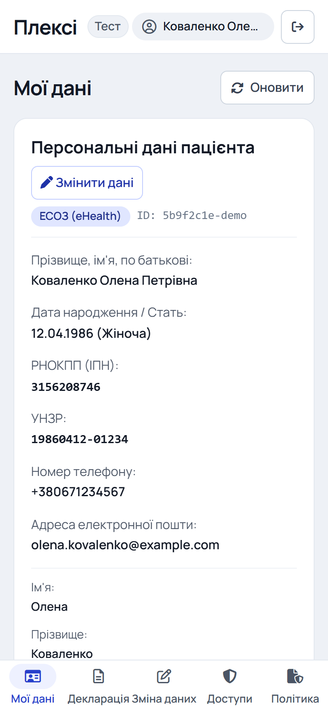<figcaption>Веб-версія на телефоні: розділи — у нижніх вкладках</figcaption></figure>

<figure>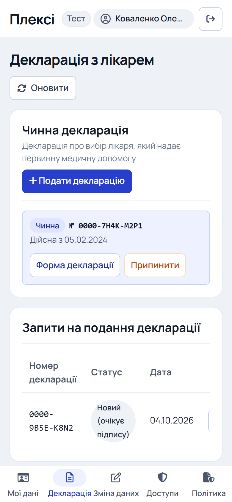<figcaption>Веб-версія на телефоні: декларація з лікарем</figcaption></figure>

---

## 1. Вхід до кабінету (ТВ 3.3)

### 1.1. Згода з Політикою конфіденційності (ТВ 3.3.1)
1. На екрані входу позначте «Я ознайомився(-лась) і погоджуюсь з Політикою конфіденційності».
2. Текст Політики відкривається за посиланням поруч. Його можна зберегти як файл .txt: у вебі посилання «зберегти .txt», у застосунку пункт «Переглянути або зберегти Політику конфіденційності», а потім кнопка «Зберегти як текстовий файл (.txt)».
3. Без позначки вхід не розпочнеться: кабінет попросить підтвердити згоду.

<figure>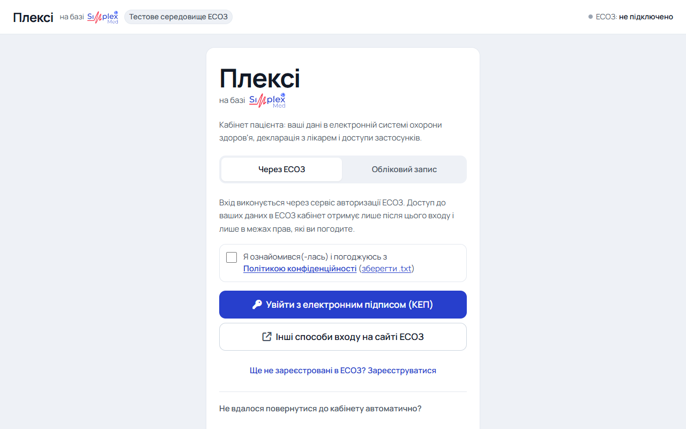<figcaption>Екран входу (веб-версія)</figcaption></figure>

<figure>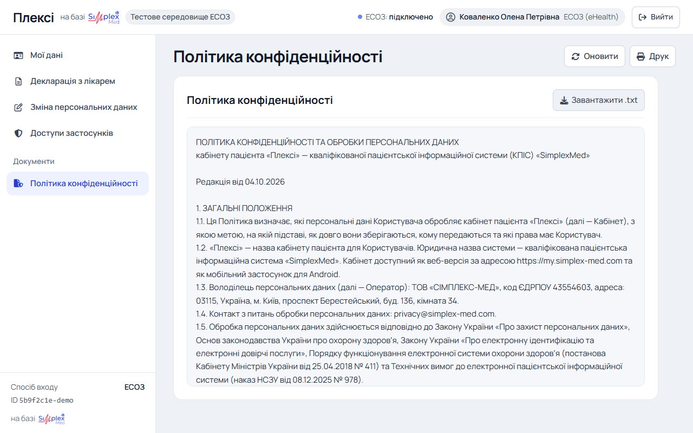<figcaption>Політика конфіденційності з можливістю зберегти .txt</figcaption></figure>

### 1.2. Вхід з кваліфікованим електронним підписом (ТВ 3.3.3–3.3.6)
1. Натисніть «Увійти з електронним підписом (КЕП)» (у вебі) або «Увійти з КЕП» (у застосунку).
2. У вікні «Електронний підпис»:
    - оберіть надавача (ЦСК) або залиште «Визначити автоматично»;
    - оберіть файл ключа (.dat, .pfx, .p12, .jks, .zs2);
    - введіть пароль до ключа.

3. Натисніть «Зчитати ключ і підписати». Кабінет покаже власника ключа і підпише одноразовий код ЕСОЗ. Ключ і пароль обробляються лише на вашому пристрої та на сервер не передаються.

4. Відкриється сторінка сервісу авторизації ЕСОЗ. Перевірте перелік прав доступу і підтвердьте його.
5. Після підтвердження ви повернетеся до кабінету.

<figure>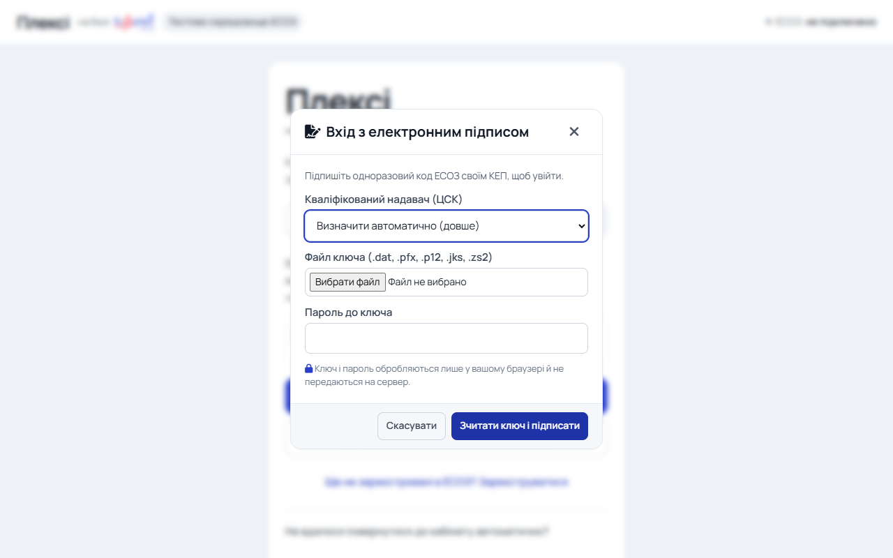<figcaption>Вікно електронного підпису</figcaption></figure>

### 1.3. Помилки входу
Кабінет показує повідомлення ЕСОЗ українською мовою за Додатком 1 ТВ. Якщо пацієнта не знайдено в ЕСОЗ, кабінет запропонує перейти до реєстрації (розділ 3).

---

## 2. Захист мобільного застосунку (ТВ 2.9, 1.4.2)

1. Після першого входу встановіть PIN-код застосунку (4–6 цифр) і повторіть його. За бажанням увімкніть вхід за біометрією (відбиток пальця або обличчя).
2. Застосунок блокується і вимагає PIN-код або біометрію:
    - через 5 хвилин без жодних дій;
    - після закриття, вивантаження чи перезапуску застосунку;
    - після виходу з кабінету.

3. Після 5 неправильних спроб введення PIN-коду дані кабінету на пристрої стираються, і потрібен повторний вхід.
4. Заблокувати застосунок вручну можна кнопкою з замком на головному екрані або пунктом «Заблокувати» у вкладці «Ще».
5. Знімки екрана застосунку заборонені, щоб дані не потрапили до галереї чи переліку останніх застосунків.

У веб-версії сесія завершується після 30 хвилин бездіяльності та після закриття браузера.

---

## 3. Реєстрація в ЕСОЗ через кабінет (ТВ 3.5)

1. На екрані входу натисніть «Ще не зареєстровані в ЕСОЗ? Зареєструватися».
2. Заповніть форму. Поля з позначкою * обов'язкові.

    - **Персональні дані:** ПІБ, дата народження, стать, країна і місце народження, УНЗР, РНОКПП або позначка «Відмовився(-лась) від РНОКПП», кодове слово (6–20 літер чи цифр), електронна пошта, бажаний спосіб зв'язку. Дати вводяться у форматі ДД.ММ.РРРР. Адреси пошти заборонених сервісів (наприклад, на доменах .ru) не приймаються.
    - **Документ, що посвідчує особу:** тип, серія та номер, дата видачі, ким виданий, дійсний до.
    - **Документ про дієздатність:** для пацієнтів віком від 14 до 18 років кабінет показує додатковий блок.
    - **Адреса проживання:** область, населений пункт (почніть вводити назву й оберіть зі списку), вулиця, будинок, квартира, індекс.
    - **Контакти:** мобільний телефон, телефон для автентифікації (SMS), особа для екстреного зв'язку.

3. Позначте згоду з Політикою конфіденційності.
4. Натисніть «Підписати КЕП і зареєструватися» і підпишіть дані своїм КЕП. Дані з підпису (ПІБ, РНОКПП) мають збігатися з даними форми.
5. Завершіть реєстрацію на сторінці ЕСОЗ. Кабінет повідомить: «Реєстрацію та авторизацію в ЕСОЗ успішно завершено.» (ТВ 3.5.8.1).
6. Якщо ЕСОЗ вимагає копії документів, на сторінці «Мої дані» з'явиться блок «Завантажте копії ваших документів» (розділ 6).

<figure>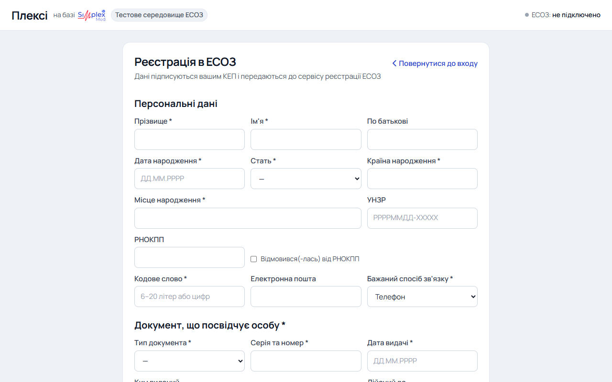<figcaption>Форма реєстрації в ЕСОЗ</figcaption></figure>

Якщо сервіс реєстрації поверне помилку, кабінет знову відкриє форму з текстом помилки, щоб ви могли виправити дані.

---

## 4. Перегляд даних про себе (ТВ 3.9)

Розділ «Мої дані»: у вебі в меню ліворуч, на телефоні в нижніх вкладках.

1. **Запис про пацієнта (ТВ 3.9.2).** Усі відомості з ЕСОЗ:
    - ПІБ, дата народження, стать, РНОКПП, УНЗР;
    - документи, адреси, телефони, електронна пошта;
    - особа для екстреного зв'язку, кодове слово та інші дані.

2. **Статуси верифікації (ТВ 3.9.3).** Окремо за кожним напрямом показуються статус, причина, коментар і повідомлення з порадою. Якщо дані треба виправити, у повідомленні є посилання на сторінку звернень НСЗУ.
3. **Методи автентифікації (ТВ 3.9.4).** Діючі методи входу до ЕСОЗ: тип, номер телефону, назва.

<figure>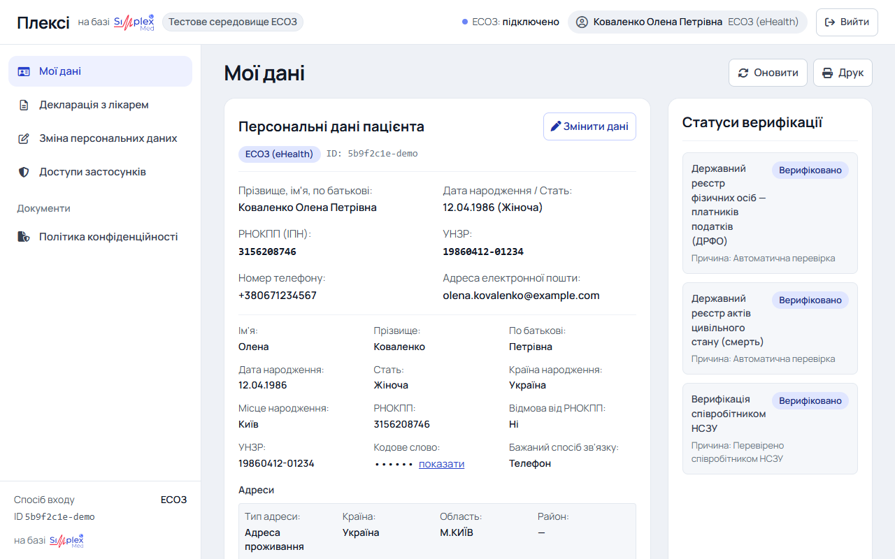<figcaption>Мої дані: персональні дані і статуси верифікації</figcaption></figure>

<figure>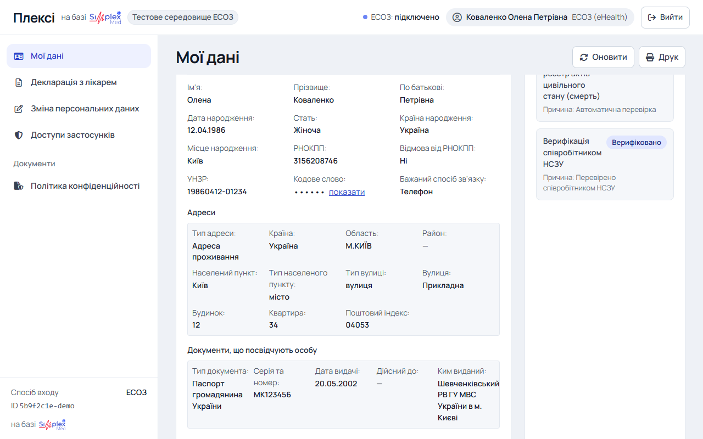<figcaption>Повний запис про пацієнта з ЕСОЗ</figcaption></figure>

<figure><figcaption>Статуси верифікації за напрямами</figcaption></figure>

Кнопка «Оновити» (у вебі вгорі сторінки) або жест «потягнути вниз» (у застосунку) заново отримує дані з ЕСОЗ.

---

## 5. Методи автентифікації (ТВ 3.9.4, 3.9.5)

1. У блоці «Методи автентифікації в ЕСОЗ» (у вебі) або на екрані «Методи входу» (у застосунку) натисніть «Додати номер телефону для входу».
2. Введіть номер мобільного телефону та код із SMS. Якщо код не надійшов, скористайтеся «Надіслати код повторно».
3. Методу «телефон» можна дати назву: «Змінити назву», потім «Зберегти назву». У застосунку метод можна також деактивувати кнопкою «Деактивувати». Дії підтверджуються так, як вимагає ЕСОЗ.

<figure>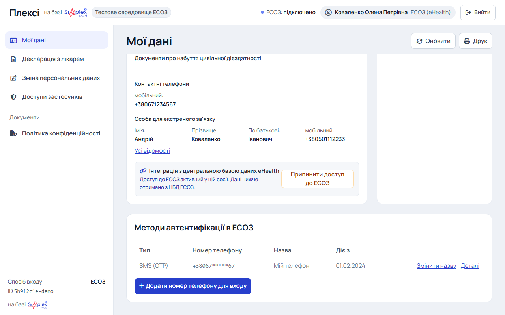<figcaption>Методи автентифікації в ЕСОЗ</figcaption></figure>

---

## 6. Передання копій документів (ТВ 3.6)

1. Якщо ЕСОЗ вимагає копії документів (після реєстрації або за статусом верифікації), на сторінці «Мої дані» з'являється блок «Завантажте копії ваших документів». У застосунку він розташований на екрані «Запити на зміну даних».
2. Для кожного документа оберіть файл: PDF, JPG, PNG або BMP, до 20 МБ. Назва файлу не повинна містити символи ЫЪЭЁыъэё@%&$^#.
3. Після завантаження всіх файлів натисніть «Завершити завантаження».

---

## 7. Зміна персональних даних (ТВ 3.10)

1. У розділі «Мої дані» або «Зміна персональних даних» натисніть «Змінити дані».
2. Відредагуйте дані у формі. РНОКПП і УНЗР, внесені раніше, змінити не можна.

3. Натисніть «Далі: документи та підпис». Якщо у вас є запити на декларацію у статусі «Новий» або «Підтверджений», кабінет попередить, що вони будуть анульовані, а чинна декларація залишиться дійсною (ТВ 3.10.1.5).
4. Завантажте копії документів, якщо ЕСОЗ їх вимагає. Перегляньте форму («Переглянути форму»).
5. Натисніть «Підписати КЕП» і підпишіть запит.
6. **Запити на зміну даних (ТВ 3.10.2).** Перелік запитів показує дату створення, статус і того, хто вніс зміни. Незавершений запит можна продовжити («Продовжити») або скасувати.

<figure>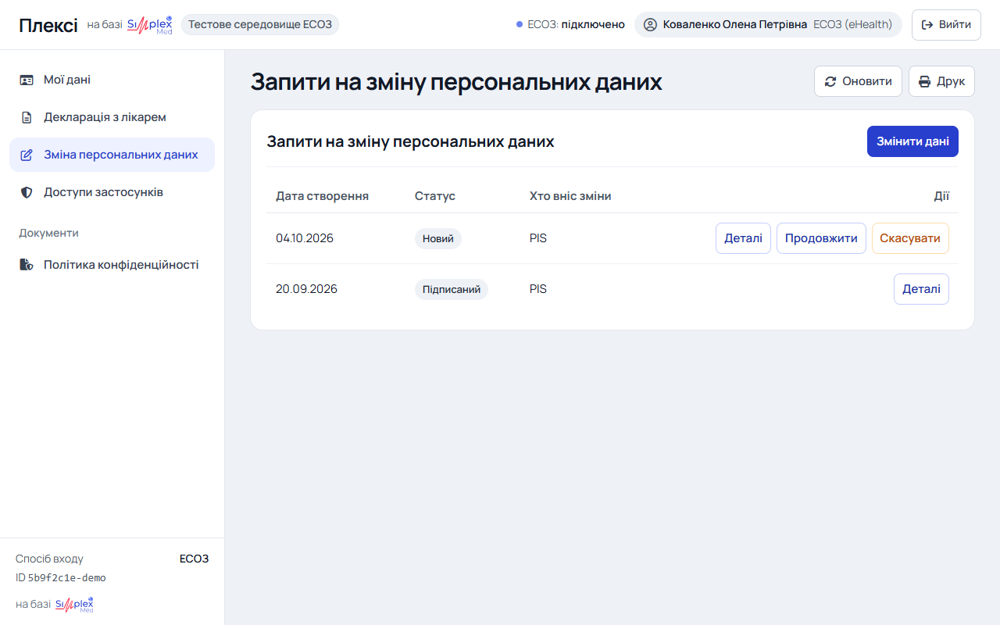<figcaption>Запити на зміну персональних даних</figcaption></figure>

<figure>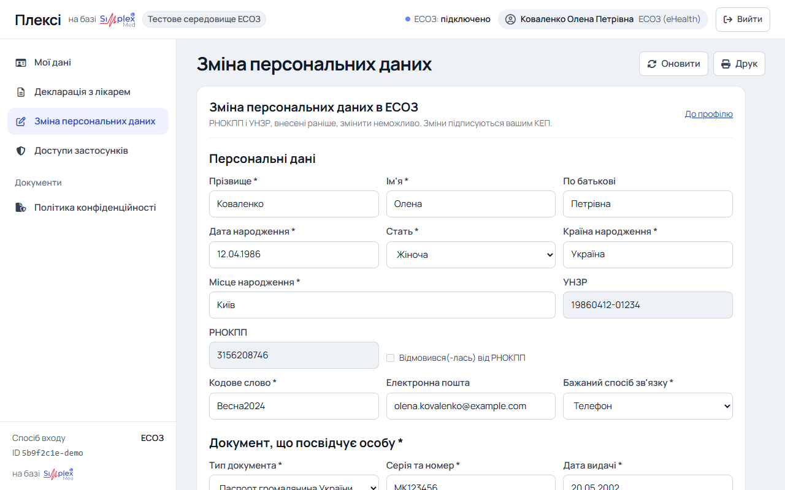<figcaption>Форма зміни персональних даних</figcaption></figure>

---

## 8. Декларація з лікарем (ТВ 3.11)

### 8.1. Подання декларації (ТВ 3.11.1)
1. У розділі «Декларація з лікарем» (у вебі) або «Декларації» (у застосунку) натисніть «Подати декларацію».
2. Знайдіть лікаря. Фільтри: ПІБ, спеціальність, стать лікаря, назва закладу, місце надання послуг (МНП), адреса МНП, ліміт декларацій, договір з НСЗУ. Натисніть «Знайти». Перелік спеціальностей залежить від вашого віку.
3. «Про лікаря» показує освіту, кваліфікації, спеціальності, вік і стаж.

4. Натисніть «Обрати». Кабінет попередить:
    - якщо лікар має рекомендовану кількість пацієнтів (запит піде на погодження лікарю);
    - якщо до ліміту лишилося менше 20 місць;
    - якщо МНП не має договору з НСЗУ.

5. Перегляньте форму декларації і натисніть «Підписати КЕП».
6. Після підпису кабінет повідомить результат. Наприклад: «Вітаємо з вибором лікаря! Декларацію № … лікарю … успішно подано.» Або: запит надіслано лікарю на погодження.
7. Форму декларації можна зберегти: «Завантажити PDF» (файл .pdf).

<figure>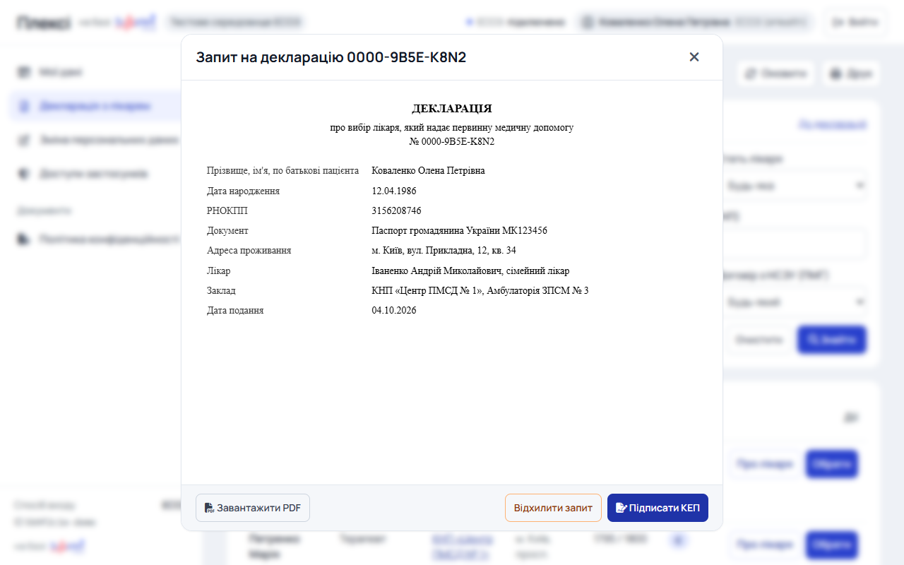<figcaption>Форма запиту на декларацію: підпис, відхилення, PDF</figcaption></figure>

<figure>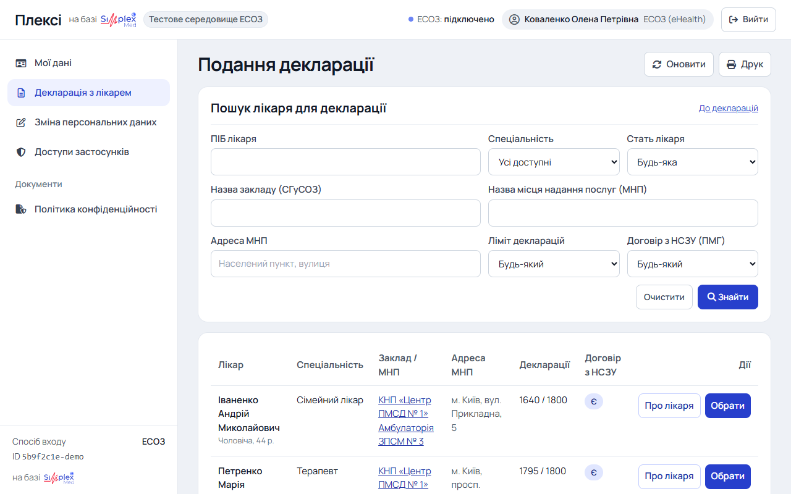<figcaption>Пошук лікаря для декларації</figcaption></figure>

### 8.2. Запити на подання декларації (ТВ 3.11.2)
- Таблиця «Запити на подання декларації» показує номер, статус і дату.
- **Продовжити.** Запит у статусі «Новий» можна продовжити й підписати. Попередження п.8.1 крок 4 показуються повторно.
- **Відхилити.** Запит у статусі «Новий» або «Підтверджений» можна відхилити, підтвердивши, що дія незворотна.
- **Деталі.** Показують форму запиту з можливістю завантажити PDF.

### 8.3. Перегляд і припинення декларації (ТВ 3.11.3, 3.11.4)
1. Блок «Чинна декларація» показує номер, статус і дату початку. «Форма декларації» відкриває форму з кнопкою «Завантажити PDF».
2. Щоб припинити декларацію, натисніть «Припинити», за бажанням вкажіть причину і підтвердіть: «Увага! Припинення дії Декларації є незворотною дією. Ви впевнені?»
3. «Інші декларації» показує попередні декларації зі статусом, датами, причиною та її описом.

<figure>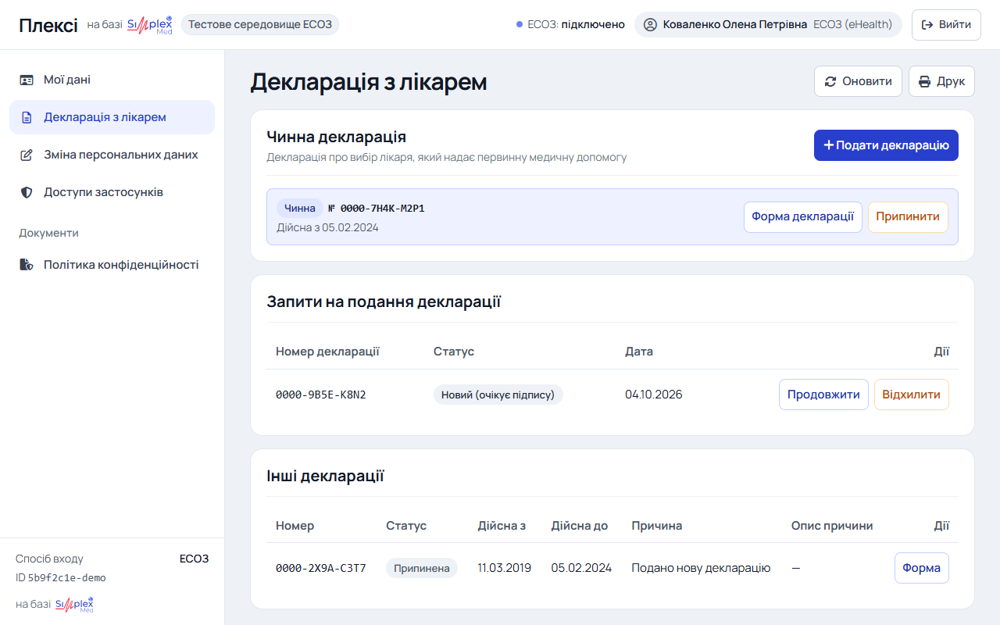<figcaption>Чинна декларація, запити на декларацію та інші декларації</figcaption></figure>

Якщо ЕСОЗ відповідає, що пацієнт не верифікований, кабінет пропонує перейти до зміни персональних даних (Додаток 1 ТВ).

---

## 9. Доступи застосунків (ТВ 3.8)

1. Розділ «Доступи застосунків» показує пацієнтські системи, яким ви надали доступ до своїх даних в ЕСОЗ: назву, перелік доступів і дату.
2. Щоб відкликати доступ, натисніть «Відкликати» і підтвердіть.
3. Якщо ви відкликаєте доступ самого кабінету «Плексі», кабінет попередить про це і завершить сесію.

<figure>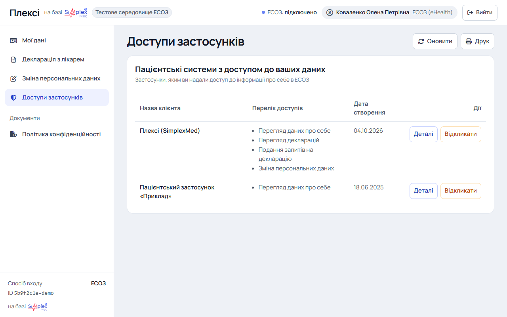<figcaption>Доступи застосунків</figcaption></figure>

---

## 10. Вихід (ТВ 3.7)

- **Веб-версія:** кнопка «Вийти» у верхньому правому куті.
- **Застосунок:** вкладка «Ще», пункт «Вийти з кабінету», потім підтвердження.

Під час виходу кабінет повідомляє ЕСОЗ про припинення дії токенів доступу. Якщо ЕСОЗ поверне помилку, кабінет її покаже.

У вебі в розділі «Мої дані» також є кнопка «Припинити доступ до ЕСОЗ». Вона припиняє доступ до ЕСОЗ у поточній сесії без виходу з облікового запису кабінету.

---

## 11. Підтримка

- Технічна підтримка кабінету: support@simplex-med.com
- Питання щодо персональних даних: privacy@simplex-med.com
- Звернення до НСЗУ щодо даних у реєстрах ЕСОЗ: https://nszu.gov.ua/gromadianam/onlain-formi
